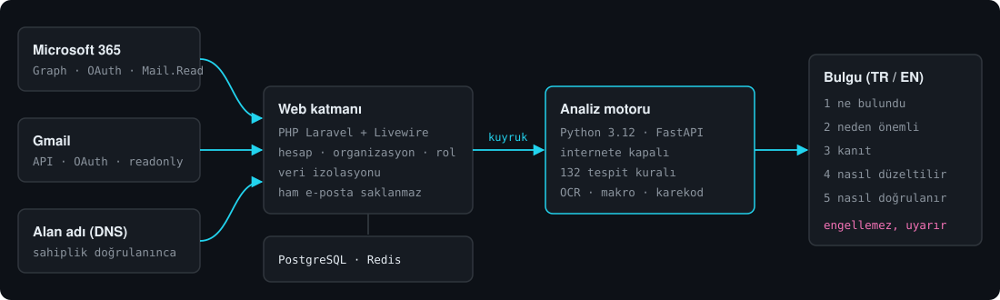

  

  
  
  
  

  <b>Açık olduğum roller</b> &nbsp;·&nbsp; Siber Güvenlik Stajı &nbsp;·&nbsp; Junior SOC Analyst &nbsp;·&nbsp; IT Destek / Help Desk &nbsp;·&nbsp; Sağlık BT &nbsp;·&nbsp; <i>İstanbul / Hibrit / Uzaktan</i>

---

## Hakkımda

Dokuz yıla yakın ameliyathanede **anestezi teknikeri** olarak çalıştım. İşim, monitördeki sinyalleri sürekli izlemek, normalden sapmayı erken fark etmek, protokole uymak ve her uygulamayı kayıt altına almaktı. Bugün aynı refleksi **siber güvenliğe** taşıyorum: sinyal artık hastadan değil, sistemlerden ve e-postalardan geliyor.

Kariyer değişikliğimi kendim planladım. **Bilgisayar Programcılığı** önlisansını onur öğrencisi olarak bitirdim, 120 saatlik siber güvenlik eğitimi aldım, Cisco'nun Introduction to Cybersecurity kursunu tamamladım; TryHackMe'de 12 oda bitirdim, Hack The Box'ta log incelemesine dayalı Brutus senaryosunu çözdüm. Öğrendiklerimi denemek için tek başıma, **Claude Code** ile bir e-posta güvenliği ürünü geliştirdim: **ProofSender**.

Mentorluk veren, yapılandırılmış bir güvenlik ekibinde **L1 SOC / güvenlik stajyeri** olarak başlamak istiyorum.

<table>
  <tr>
    <th align="left">🛡️ Güvenlik Temelleri</th>
    <th align="left">✉️ E-posta Güvenliği</th>
    <th align="left">🐧 Linux &amp; Ağ</th>
    <th align="left">🏥 Ameliyathaneden Gelen</th>
  </tr>
  <tr>
    <td valign="top">Saldırı vektörleri ve savunma Log ve olay analizi (temel) Kimlik doğrulama, erişim kontrolü Kriptografi, hash, şifreleme</td>
    <td valign="top">SPF · DKIM · DMARC MTA-STS · TLS-RPT · DNSSEC Oltalama ve benzer alan adı Sahte fatura / IBAN sinyalleri</td>
    <td valign="top">Linux komutları, Kali (temel) TCP/IP, subnetting (temel) DNS, HTTP/HTTPS Nmap ile port ve servis keşfi</td>
    <td valign="top">Sürekli izleme ve alarm takibi Baskı altında sakin karar Protokol ve kontrol listesi Hassas veri ve mahremiyet</td>
  </tr>
</table>

---

## Proje

### ProofSender · e-posta güvenliği SaaS · [proofsender.com](https://proofsender.com)

> **Kapalı beta.** Kaynak kodu gizli, bu yüzden repo yerine canlı siteye bağlantı veriyorum. Ürünü **tek başıma**, **Claude Code** ile geliştirdim (Ekim 2026'dan beri, tüm commit'ler bana ait).

Küçük ve orta ölçekli şirketleri iki yerden korur: **alan adının sahteciliğe karşı yapılandırması** ve **gelen kutusuna düşen oltalama ve sahte fatura e-postaları**. E-postayı engellemez; şüpheli olanı açıklamalı bir uyarıyla bildirir.

<table>
  <tr>
    <td align="center"><h3>132</h3>tespit kuralı</td>
    <td align="center"><h3>7</h3>DNS / e-posta protokolü analizi</td>
    <td align="center"><h3>697</h3>pytest testi (engine)</td>
    <td align="center"><h3>67</h3>PHPUnit test dosyası (web)</td>
  </tr>
</table>

  

**Alan adı koruması**
- **SPF, DKIM, DMARC, MX, MTA-STS, TLS-RPT ve DNSSEC** kayıtlarını analiz eden ayrı analizörler; sürekli izleme ve DMARC raporları
- Her bulgu aynı modelle, Türkçe ve İngilizce: *ne bulundu, neden önemli, kanıt, nasıl düzeltilir, nasıl doğrulanır*

**Gelen kutusu analizi**
- MIME ayrıştırma, kimlik doğrulama sonuçlarının yorumlanması, **benzer alan adı (lookalike)** tespiti
- Bağlantı ve **karekod** analizi, **Office makro (VBA)** analizi
- Faturalardan **IBAN çıkarma**, taranmış PDF'ler için **Tesseract OCR**

**Güvenlik ve gizlilik tasarımı**
- Organizasyonlar arası **veri izolasyonu**; her kullanıcı girdisi **güvenilmeyen veri** olarak işlenir
- **Ham e-posta saklanmaz**; Gmail ve Microsoft 365'e yalnızca okuma izniyle bağlanılır
- **Alan adı sahipliği doğrulanmadan** izleme başlamaz
- **GitHub Actions CI:** testler, statik analiz, bağımlılık denetimi; Docker Compose ile yedekleme ve geri yükleme betikleri

    

---

## Araçlar

**Güvenlik ve sistem** 
     

**ProofSender'da kullandıklarım (Claude Code ile)** 
        

**Programlama (temel)** 
   

---

## Eğitim ve Sertifikalar

- **Bilgisayar Programcılığı (Önlisans)** · Anadolu Üniversitesi · 2024 → 2026 · mezun, GNO 3.18 / 4, **Onur Öğrencisi**
- **Siber Güvenlik Uzmanlığı Eğitimi (120 saat)** · Unityverse Academy · Ocak 2024 · katılım belgesi; kriptografi, uygulama güvenliği, saldırı tespit sistemleri, olay yanıtı ve adli bilişim
- **Cisco Networking Academy · Introduction to Cybersecurity** · Kasım 2026 · tamamlandı
- **TryHackMe** · [hyny](https://tryhackme.com/p/hyny) · 12 oda, Top %30 · SOC Role in Blue Team, Junior Security Analyst Intro, Defensive Security Intro, Web Application Security, Guided Pentest: Web
- **Hack The Box** · crescent07 · **Brutus** Sherlock (Ekim 2024): auth.log ve wtmp kayıtlarından SSH kaba kuvvet saldırısı incelemesi
- **Anestezi (Önlisans)** · İstanbul Aydın Üniversitesi · 2013 → 2015

---

  <code>yalnızca yetkili test · sorumlu bildirim</code>

